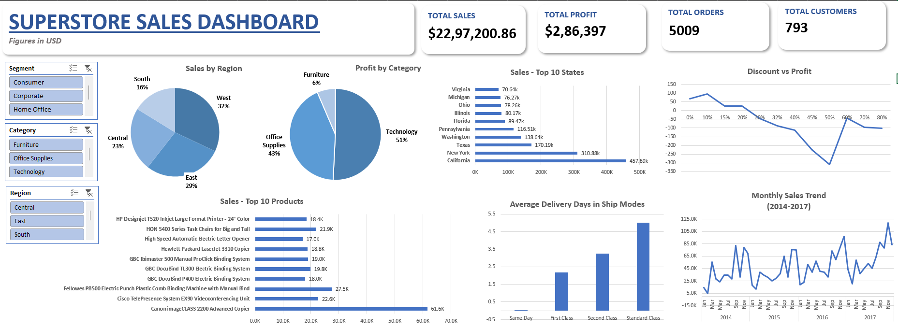

# Superstore Sales Dashboard (Excel)

## Project Overview

This project analyzes Superstore Sales data using Microsoft Excel for identifying sales trends, profitability, customer behaviour and regional performance. An interactive excel dashboard was created which consists of slicers and charts that will help business users in understanding/exploring key metrics.
---
## About Dataset

- Dataset: Sample Superstore Sales Dataset 
- Source: Kaggle
- Time Period: 2014-2017
---
## Dashboard Preview

---
## Business Problems

The following questions are answered by this dashboard:

- Which region generates the highest sales?
- Which product category produces the highest profit?
- Which states are our highest contibuters?
- Which products are selling the most?
- How does discount relate to profit?
- How do sales performs monthly each year?
- Which shipping method takes the longest delivery time?
---
## Dashboard Features

- KPI Cards
    - Total Sales
    - Total Profit
    - Total Orders
    - Total Customers

- Interactive slicers
    - Segment
    - Category
    - Region

- Visualizations
    - Sales by Region
    - Profit by Category
    - Monthly Sales Trend
    - Top 10 Products
    - Top States by Sales
    - Avergae Delivery Days by Ship Mode
    - Discount vs Profit
---
## Data Cleaning

Used Power Query for preparing the data.

Following cleaning steps were performed

- Converted columns to appropriate data types
- Corrected date formats
- Created Days to Deliver calculated column
- Verified numeric fields
- Loaded cleaned data into Excel for analysis
---
## Tools Used

- Microsoft Excel
- Power Query
- Pivot Tables
- Pivot Charts
- Slicers
- Excel Formulas & Shapes
---
## Key Insights

- West region generated the highest sales.
- Technology was the most profitable category.
- Standard Class had the highest average delivery time.
- Higher dicounts were associated with lower porfits.
- Sales generally increased in the last quarter of each year.
