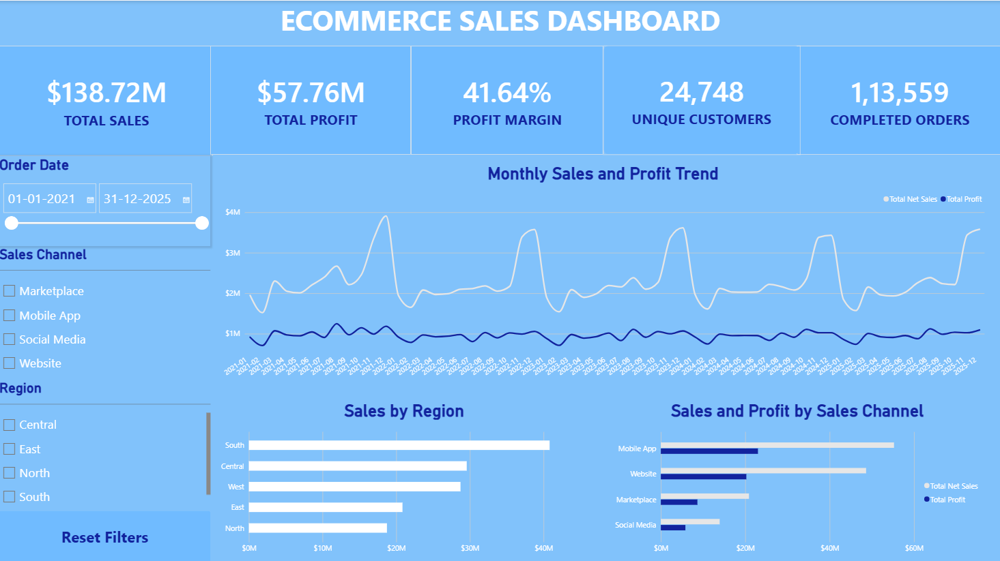

# E-commerce Sales, Pricing & Customer Analytics Dashboard

**Tools:** Microsoft Excel | Power Query | MySQL | Power BI | DAX

## Project Overview

This portfolio project analyzes an e-commerce sales and customer analytics dataset to explore revenue, profitability, discount patterns, sales channels, regional performance, and customer purchasing behavior.

## Business Questions

- How do sales and profit change over time?
- Which regions and sales channels contribute the most sales and profit?
- How do discount rates relate to profit margins?
- How does performance vary across customer segments?
- What proportion of customers place repeat orders?
- How are orders distributed across completion, return, cancellation, and pending statuses?

## Dataset

- **Source:** [E-Commerce Sales and Customer Analytics (Kaggle)](https://www.kaggle.com/datasets/datascikhan/e-commerce-sales-and-customer-analytics?select=ecommerce_sales_customer_analytics_150k.csv)
- **Rows analyzed:** 138,116
- **Date range:** January 2021–December 2025
- **Scope:** Order details, customers, regions, sales channels, discounts, costs, and profitability

Financial KPIs on the dashboard are calculated using **Completed** orders only. The order-status chart includes all records. Financial fields were standardized to USD during data preparation.

## Workflow

### 1. Data preparation — Excel & Power Query

- Reviewed data types, order dates, status values, and relevant fields.
- Prepared a streamlined dataset for analysis.
- Merged reference exchange-rate data and created USD-denominated financial columns for consistent comparisons.
- Exported the prepared dataset for MySQL analysis.

### 2. SQL analysis — MySQL

Analyzed monthly sales and profit trends, regional and channel performance, customer segments, discount rates, and repeat-purchase behavior. See [`sql/data_analysis.sql`](sql/data_analysis.sql)

### 3. Dashboard — Power BI

Built two interactive report pages with DAX measures, slicers, KPI cards, line charts, bar charts, and donut charts.

**Page 1 — Executive Overview**
- Total net sales, total profit, profit margin, completed orders, and unique customers
- Monthly sales and profit trend
- Regional sales comparison
- Sales and profit by channel
- Date, region, and channel slicers

**Page 2 — Pricing & Customer Insights**
- Monthly discount rate versus profit margin
- Sales and profit by customer segment
- Repeat versus one-time customer distribution
- Order-status breakdown
- Customer segment slicer

## Key Findings

| Metric | Result |
|---|---:|
| Completed orders | 113,559 |
| Net sales from completed orders | $138.72M |
| Profit from completed orders | $57.76M |
| Profit margin | 41.64% |
| Unique customers with completed orders | 24,748 |
| Repeat customers | 23,521 (95.04%) |
| One-time customers | 1,227 (4.96%) |

- **Seasonality:** Sales were generally strongest toward November and December, with recurring November discount spikes and lower profit margins.
- **Discounts and profitability:** Across 60 monthly observations, the effective discount rate and profit margin showed a strong negative correlation (**r = −0.977**). This is an association, not evidence of causation.
- **Regions:** The South generated the highest net sales, while the North had the highest profit margin among the five regions.
- **Channels:** Mobile App contributed the most sales, while profit margins were relatively similar across channels.
- **Customers:** Repeat customers represented **95.04%** of customers with completed orders in this dataset.

## Dashboard Preview

### Executive Overview

### Pricing & Customer Insights

